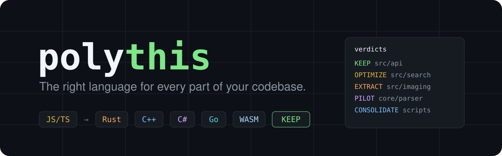

<p align="center">
  
</p>

<p align="center">
  <a href="https://skills.sh/marquezinii/polythis"></a>
  <a href="LICENSE"></a>
  <a href="https://agentskills.io"></a>
  
</p>

<p align="center">
  <b>Is every part of your codebase written in the right language?</b><br>
  <code>polythis</code> is an agent skill that audits <i>language fit</i>, module by module, and tells you<br>
  what to keep, what to optimize, what to move to C++, Rust, C#, Go or WASM, and what to consolidate.
</p>

```bash
npx skills add marquezinii/polythis
```

---

## Why

Your agent writes the whole project in the language you started with. That is usually right, until it isn't:

- an Electron app whose export filters freeze the window because pixel loops run in JavaScript,
- a Python service whose hot parser burns CPU behind the GIL,
- a Java or Go path where GC pauses wreck p99 latency,
- a C++ parser that keeps producing memory-safety CVEs,
- or a repo carrying a whole extra toolchain for 400 lines of scripts.

Ask an agent "should this be in Rust?" without guidance and you tend to get a vibe-based yes. **polythis makes the agent prove it.** It defaults to **KEEP**, demands evidence, does the Amdahl math, prices the boundary, the build matrix, and the team, and only then recommends extracting a module.

## What you get

A report that leads with a verdict table and a concrete next step:

| # | Module | Workload | Current | Verdict | Target & boundary | Expected gain | Confidence |
|---|---|---|---|---|---|---|---|
| 1 | `src/imaging/` | CPU-bound pixels | JavaScript | **EXTRACT** | Rust via napi-rs, one async call per image | ~3–5× export time `[benchmarked]` | medium |
| 2 | `src/search/` | CPU, algorithmic | JavaScript | **OPTIMIZE IN PLACE** | trigram index, off the main process | search under 16 ms `[inferred]` | low |
| 3 | `src/api/` | I/O-bound | JavaScript | **KEEP** | move filtering into SQL | — | high |
| 4 | `scripts/*.py` | tooling | Python | **CONSOLIDATE** | rewrite in JS, drop Python from CI | one fewer toolchain | high |

Each candidate then gets its evidence, the options it walked through, a score, a boundary design, the distribution plan, risks, and the first PR-sized step.

## How it works

1. **Frame** the goal (throughput, latency, memory, startup, safety, maintainability, cost) and the deployment target. Browser, Electron, serverless, mobile, and embedded each constrain what is possible.
2. **Inventory** the repo with a bundled zero-dependency script: languages, manifests, existing FFI/addons/WASM/sidecars, hotspots (size × churn), bug-fix and perf-fix density, and compute-heavy code in dynamic languages.
3. **Shortlist** at most five candidate seams by workload type, plus *consolidation* candidates (languages that cost more toolchain than they are worth).
4. **Gather evidence** and label every claim `[measured]` `[benchmarked]` `[profiled]` `[history]` or `[inferred]`. No invented numbers. Every performance claim goes through the Amdahl check.
5. **Walk the options ladder**: keep → optimize in place → adopt a native-backed library → extract a module → rewrite a service → rewrite the project. Stop at the first rung that meets the goal.
6. **Score** gain, fit, and pain against boundary, migration, ops, and team costs, with **hard gates**: no EXTRACT on `[inferred]` evidence alone, no port without a parity oracle, no whole-project rewrite unless every module independently earns it.
7. **Report** with a fixed template, including a "what not to rewrite" section so the next person doesn't relitigate it.

It is an **audit**: the agent does not touch your code unless you ask it to proceed. If you do, it follows a strangler-style plan: freeze the interface, build a parity oracle and a benchmark, ship behind a flag, diff both implementations, then switch.

## Install

The [`skills`](https://github.com/vercel-labs/skills) CLI detects the coding agents on your machine and installs to the ones you choose. Requires Node.js 22.20+.

```bash
# Current project, choose agents interactively
npx skills add marquezinii/polythis

# Everywhere (user-level) instead of just this project
npx skills add marquezinii/polythis -g
```

Install straight into a specific agent with `-a`:

| Agent | Command |
|---|---|
| Claude Code | `npx skills add marquezinii/polythis -a claude-code` |
| OpenAI Codex | `npx skills add marquezinii/polythis -a codex` |
| Cursor | `npx skills add marquezinii/polythis -a cursor` |
| GitHub Copilot | `npx skills add marquezinii/polythis -a github-copilot` |
| Gemini CLI | `npx skills add marquezinii/polythis -a gemini-cli` |
| OpenCode | `npx skills add marquezinii/polythis -a opencode` |
| Windsurf | `npx skills add marquezinii/polythis -a windsurf` |
| Cline | `npx skills add marquezinii/polythis -a cline` |
| Roo Code | `npx skills add marquezinii/polythis -a roo` |
| Amp | `npx skills add marquezinii/polythis -a amp` |
| Kiro CLI | `npx skills add marquezinii/polythis -a kiro-cli` |
| Goose | `npx skills add marquezinii/polythis -a goose` |
| Antigravity | `npx skills add marquezinii/polythis -a antigravity` |
| Droid (Factory) | `npx skills add marquezinii/polythis -a droid` |

Several at once: `-a claude-code -a codex -a cursor`. See the [full list of 70+ supported agents](https://github.com/vercel-labs/skills/blob/main/docs/agents.md).

**Try it without installing:**

```bash
npx skills use marquezinii/polythis@polythis --agent claude-code
```

<details>
<summary><b>Claude Code plugin marketplace</b></summary>

```text
/plugin marketplace add marquezinii/polythis
/plugin install polythis@polythis
```
</details>

<details>
<summary><b>Manual install</b></summary>

Copy `skills/polythis/` into your agent's skills directory, for example:

```bash
git clone https://github.com/marquezinii/polythis
cp -r polythis/skills/polythis ~/.claude/skills/      # Claude Code
cp -r polythis/skills/polythis ~/.agents/skills/      # Codex, Cline, Warp, Zed, Pi, and other .agents readers
cp -r polythis/skills/polythis ~/.cursor/skills/      # Cursor
```
</details>

**Update:** `npx skills update polythis` · **Remove:** `npx skills remove polythis`

## Use it

Most agents load the skill automatically when your request matches. You can also call it by name.

```text
Use polythis on this repo.
Which parts of this project would be better in another language?
Our Electron app freezes on export. Should the image pipeline be a C++ or Rust native module?
Is Python still the right choice for the ingestion service, or should it be Go?
We have GC spikes in the market-data handler. C++ rewrite or tune Java first?
Audit src/parser only. Goal: memory safety.
We use five languages in this monorepo. Which ones can we drop?
```

## The inventory script

The bundled script also works on its own. It is read-only, has no dependencies, and runs on Node 18+.

```bash
node skills/polythis/scripts/inventory.mjs /path/to/repo --months 12 --top 15
node skills/polythis/scripts/inventory.mjs /path/to/repo --json > inventory.json
```

It reports language shares, build manifests, existing interop (N-API, PyO3, pybind11, P/Invoke, JNI/Panama, cgo, WASM, sidecars, gRPC/Aeron), module language mix, hotspots by size × churn, bug-fix and perf-fix commit counts, compute-heavy patterns in dynamic languages, and small-footprint toolchains worth consolidating.

## What's inside

```text
skills/polythis/
├── SKILL.md                      # workflow, scoring rubric, hard gates, red flags
├── scripts/inventory.mjs         # zero-dependency repository inventory
└── references/
    ├── signals.md                # what to look for, per current language
    ├── language-profiles.md      # C, C++, Rust, Zig, Go, C#, Java/Kotlin, Swift, JS/TS, Python, SQL, GPU, WASM…
    ├── interop.md                # host × guest boundary matrix, Electron notes, distribution checklist
    ├── report-template.md        # the output format
    └── case-studies.md           # calibration cases and well-known public migrations
```

The skill loads progressively: the agent reads `SKILL.md` first and opens each reference only when a step needs it.

## FAQ

**Will it rewrite my code?** No. It produces an audit. It only plans or starts a port if you explicitly ask it to.

**Does it just tell me to use Rust?** It is biased the other way. KEEP is the default, cheaper rungs (optimize in place, adopt a library) must be ruled out first, and any port without measured evidence is capped at a time-boxed PILOT.

**Which languages does it cover?** Any. Signals and profiles cover JavaScript/TypeScript, Python, Ruby, PHP, Java, Kotlin, C#, Go, C, C++, Rust, Zig, Swift, Dart, Elixir, Lua, R, shell, SQL, GPU shading languages, and WebAssembly as a target.

**Does it need network access or an API key?** No. Everything runs locally in your agent.

**Monorepos?** Yes. Scope it to a package (`audit packages/engine only`) or run it over the whole tree.

## Contributing

Issues and pull requests are welcome, especially new language signals, interop recipes, and calibration cases from real migrations. See [CONTRIBUTING.md](CONTRIBUTING.md).

If polythis saved you from a rewrite, or pointed you at the one that mattered, a ⭐ helps other people find it.

## License

[MIT](LICENSE)
